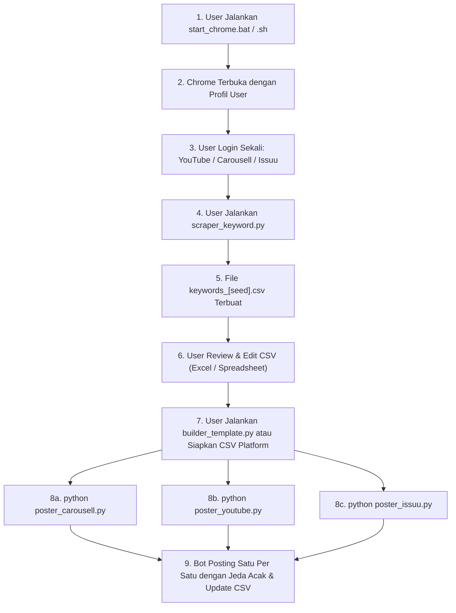

# PRD: Multi-Platform Mass Auto-Posting & Keyword Intelligence Bot

## 1. Executive Summary & Goals
- **Objective**: Membangun ekosistem bot otomatisasi modular berbasis Python & Browser Chrome nyata (via CDP/Remote Debugging) untuk melakukan riset kata kunci Google (Alphabet Soup A-Z + 0-9) dan memposting konten secara massal ke 3 platform utama: **Carousell Marketplace**, **YouTube (Video & Shorts)**, dan **Issuu (PDF Publish)**.
- **Target Audience**: Pemasar digital, pemilik bisnis/UKM, content creator, dan affiliate marketer yang memerlukan distribusi konten dan listing produk secara massal, terstruktur, dan aman dari blokir/ban platform.
- **Key Metrics / Success Criteria**:
  - Tingkat keberhasilan scraping Google Suggest > 99% tanpa CAPTCHA/blokir rate-limit.
  - Zero-bot-detection: Bebas flag `navigator.webdriver` pada Chrome melalui metode Chrome DevTools Protocol (CDP) attach.
  - Akurasi input form > 95% pada ketiga platform target (Carousell, YouTube Studio, Issuu).
  - Resume-capability: Mampu melanjutkan proses posting jika terhenti tanpa terjadi duplikasi postingan.
  - 100% kompatibel di Windows (10/11) dan Linux.

---

## 2. Domain & Core Concepts
- `Alphabet Soup Scraping`: Teknik riset kata kunci dengan mengueri kata kunci induk (`seed`) diikuti huruf 'a' sampai 'z' dan angka '0' sampai '9' pada Google Suggest API untuk mendapatkan long-tail keywords yang dicari audiens nyata.
- `CDP (Chrome DevTools Protocol) Attach`: Metode mengendalikan browser Google Chrome resmi yang sudah diluncurkan dengan argumen `--remote-debugging-port=9222`. Script otomasi menempel ke browser user yang sudah login manual sehingga sesi akun, cookies, dan 2FA tetap aktif tanpa memicu deteksi bot.
- `Modular Script Architecture`: Setiap platform memiliki script dan format CSV mandiri (`poster_carousell.py`, `poster_youtube.py`, `poster_issuu.py`, `scraper_keyword.py`), bukan satu monolith besar.
- `Status Tracking & Idempotency`: Mekanisme pencatatan status baris CSV (`pending`, `success`, `failed`, `post_url`, `error_msg`) sehingga script dapat dihentikan dan dijalankan ulang kapan saja dengan aman.
- `Human-like Pacing`: Jeda acak dinamis (typing delay per karakter, scrolling realistis, dan jeda antar posting 60-180 detik) untuk memitigasi risiko pembatasan akun (rate limit & shadowban).

---

## 3. Scope & User Flows

### In Scope (P0 / P1)
#### **P0 (Must Have)**:
1. **Google Suggest Scraper (`scraper_keyword.py`)**:
   - Menerima kata kunci dasar (seed) via CLI/interaktif (misal: "pupuk sawit").
   - Scraping Google Suggest otomatis: Root, A-Z (`pupuk sawit a` s/d `pupuk sawit z`), dan 0-9 (`pupuk sawit 0` s/d `pupuk sawit 9`).
   - Ekspor hasil unik dan terbersihkan ke CSV mentah (`keywords_[seed].csv`).
2. **Template & Data Builder (`builder_template.py`)**:
   - Membantu konversi/pemetaan CSV kata kunci ke format siap posting untuk masing-masing platform.
   - Fitur pattern replacement: Contoh judul `"Jual {keyword} Pabrik Asli Kualitas Super"`.
3. **Carousell Marketplace Poster (`poster_carousell.py`)**:
   - Membaca `carousell_posts.csv`.
   - Mengisi: Kategori, Judul, Foto Produk (upload multi-gambar), Harga, Kondisi Barang, Deskripsi.
   - Mempublikasikan listing atau menyimpan sebagai Draft.
   - Memperbarui status per baris di CSV.
4. **YouTube Studio Poster (`poster_youtube.py`)**:
   - Membaca `youtube_posts.csv`.
   - Mengunggah video (`.mp4`), mengisi Judul, Deskripsi, Tags, opsi penonton ("Not for kids"), dan mempublikasikan ("Public" atau "Unlisted"/"Draft").
   - Mendukung format Video reguler dan Shorts.
   - Memperbarui status dan menyimpan link video di CSV.
5. **Issuu PDF Publisher (`poster_issuu.py`)**:
   - Membaca `issuu_posts.csv`.
   - Mengunggah dokumen PDF, mengisi Judul, Deskripsi, dan mempublikasikan.
   - Memperbarui status di CSV.
6. **Anti-Ban CDP Engine**:
   - Script helper launcher Chrome (`start_chrome.bat` untuk Windows, `start_chrome.sh` untuk Linux) dengan port remote debugging `9222`.
   - Skrip Python meng-attach ke instance Chrome via Playwright CDP.

#### **P1 (Should Have)**:
- CLI dashboard menggunakan `rich` dengan log warna, countdown timer jeda posting, dan tabel progres.
- Dukungan relative path dan absolute path untuk file media (gambar, video, PDF) yang bekerja mulus di Windows (`\`) dan Linux (`/`).
- Konfigurasi terpusat (`config.py` atau `config.yaml`): Jeda waktu min/max, port debugging, timeout.

### Out of Scope (P2 / Future)
- Pemecahan CAPTCHA otomatis pihak ketiga (karena user sudah login manual di profil Chrome asli, CAPTCHA diminimalkan; jika muncul, user dapat menyelesaikannya langsung di browser yang terbuka).
- Integrasi auto-edit video/gambar AI (fokus saat ini adalah scraping dan otomatisasi posting).

---

## 4. UI/UX Specification & Workflow States

### Workflow Interaksi User:


### Component States pada Script CLI:
1. **Default / Idle State**: Menampilkan banner ASCII, ringkasan baris CSV yang `pending`, konfigurasi delay, dan prompt konfirmasi `Y/n` sebelum posting dimulai.
2. **Running / Posting State**: Progress bar interaktif, detail postingan yang sedang diproses (Judul, Platform, File Media), dan hitung mundur jeda aman antar posting.
3. **Empty State**: Jika semua baris di CSV berstatus `success`, bot memberikan info: *"Semua postingan telah berhasil diproses. Tidak ada antrian pending."*
4. **Error / Retry State**: Jika terjadi error (misal selector tidak ditemukan atau timeout), status baris diubah menjadi `failed`, pesan error dicatat di kolom `error_msg`, dan bot melanjutkan ke baris berikutnya tanpa crash fatal.

---

## 5. Technical Requirements & Architecture

### 5.1 Spesifikasi Struktur CSV

#### A. CSV Hasil Scraper (`keywords_[seed].csv`):
| Kolom | Tipe | Contoh Isi |
| :--- | :--- | :--- |
| `keyword` | Text | `pupuk sawit buah lebat` |
| `seed` | Text | `pupuk sawit` |
| `type` | Text | `root` / `alphabet_b` / `number_1` |
| `scraped_at` | ISO Date | `2026-10-02T11:45:00` |

#### B. CSV Carousell (`carousell_posts.csv`):
| Kolom | Wajib? | Contoh Isi | Keterangan |
| :--- | :--- | :--- | :--- |
| `title` | Ya | `Jual Pupuk Sawit Terbaik Murah` | Judul listing |
| `category` | Opsional | `Pertanian & Berkebun` | Nama / path kategori |
| `price` | Ya | `150000` | Angka harga |
| `condition` | Ya | `Baru` (atau `Brand New`) | Kondisi barang |
| `description` | Ya | `Pupuk khusus kelapa sawit... Hubungi: 0812xxx` | Teks deskripsi lengkap |
| `image_paths` | Ya | `assets/sawit1.jpg;assets/sawit2.jpg` | Dipisahkan titik koma (`;`) |
| `status` | Auto | `pending` / `success` / `failed` | Status eksekusi bot |
| `post_url` | Auto | `https://carousell.com/p/...` | URL listing setelah terbit |
| `error_msg` | Auto | `-` | Pesan error jika gagal |

#### C. CSV YouTube (`youtube_posts.csv`):
| Kolom | Wajib? | Contoh Isi | Keterangan |
| :--- | :--- | :--- | :--- |
| `title` | Ya | `Cara Pemupukan Sawit Agar Buah Lebat` | Max 100 karakter |
| `video_path` | Ya | `assets/videos/sawit_tips.mp4` | Path file video |
| `description` | Ya | `Panduan lengkap pupuk sawit...` | Deskripsi video |
| `tags` | Opsional | `pupuk sawit, sawit unggul, pertanian` | Tag YouTube (koma) |
| `visibility` | Ya | `Public` / `Unlisted` / `Draft` | Mode publikasi |
| `made_for_kids`| Ya | `false` | Standar COPPA compliance |
| `status` | Auto | `pending` / `success` / `failed` | Status proses upload |
| `post_url` | Auto | `https://youtu.be/...` | Link video |
| `error_msg` | Auto | `-` | Pesan jika gagal |

#### D. CSV Issuu (`issuu_posts.csv`):
| Kolom | Wajib? | Contoh Isi | Keterangan |
| :--- | :--- | :--- | :--- |
| `title` | Ya | `Katalog Pupuk Sawit Organik 2026` | Judul dokumen |
| `pdf_path` | Ya | `assets/docs/katalog_sawit.pdf` | Path dokumen PDF |
| `description` | Ya | `Katalog resmi produk pupuk sawit...` | Deskripsi dokumen |
| `status` | Auto | `pending` / `success` / `failed` | Status posting |
| `post_url` | Auto | `https://issuu.com/...` | URL dokumen terbit |
| `error_msg` | Auto | `-` | Pesan error |

---

### 5.2 Arsitektur Sistem & Direktori

```
Bot-Posting/
├── assets/                  # Folder penyimpanan media (gambar, video, PDF)
│   ├── images/
│   ├── videos/
│   └── docs/
├── data/                    # Folder penyimpanan file CSV
│   ├── keywords_raw/        # Hasil scraper Google Suggest
│   ├── carousell_posts.csv
│   ├── youtube_posts.csv
│   └── issuu_posts.csv
├── launchers/               # Script pembuka Chrome Remote Debugging
│   ├── start_chrome_windows.bat
│   └── start_chrome_linux.sh
├── modules/                 # Helper & core automation engine
│   ├── __init__.py
│   ├── browser_manager.py   # CDP connector & stealth wrapper
│   ├── csv_handler.py       # Pembaca dan penulis CSV otomatis aman
│   ├── human_emulator.py    # Random delays, smooth typing, mouse simulation
│   └── logger.py            # Rich console logger
├── config.py                # Konfigurasi terpusat (delays, port CDP, timeout)
├── scraper_keyword.py       # Script mandiri: Google Suggest Scraper (Alphabet Soup)
├── builder_template.py      # Utility: Generator CSV platform dari keywords
├── poster_carousell.py      # Script mandiri: Carousell Poster Bot
├── poster_youtube.py        # Script mandiri: YouTube Studio Uploader Bot
├── poster_issuu.py          # Script mandiri: Issuu Document Publisher Bot
├── requirements.txt         # Dependensi Python
└── README.md                # Dokumentasi panduan penggunaan lengkap
```

---

### 5.3 Anti-Ban & Keamanan Akun
1. **Zero-Automation Flagging (CDP Attach)**:
   - Chrome dijalankan langsung oleh sistem operasi, bukan diluncurkan lewat webdriver Selenium standar.
   - Properti JavaScript `window.navigator.webdriver` bernilai `false` / `undefined` persis browser biasa.
   - Sesi login, cookies akun, profil ekstensi, dan riwayat browsing tetap tersimpan di direktori profil user asli.
2. **Keystroke Cadence**:
   - Tidak menggunakan `page.fill()` instan untuk teks penting.
   - Menggunakan pengetikan karakter per karakter dengan jeda acak 40ms - 150ms per karakter.
3. **Randomized Inter-Action Delays**:
   - Jeda acak antar baris posting: default 90 detik s/d 240 detik (bisa diatur di `config.py`).
   - Jeda acak antar klik tombol: 1.5 detik s/d 4 detik.
4. **Daily Rate Limiting**:
   - Opsi `MAX_POSTS_PER_RUN` di konfigurasi untuk mencegah lonjakan aktivitas tidak wajar dalam satu waktu.

---

## 6. Edge Cases & Risk Analysis

| Risiko / Edge Case | Dampak | Strategi Mitigasi |
| :--- | :--- | :--- |
| **File media (gambar/video/PDF) tidak ditemukan** | Script gagal mengupload file | Validasi eksistensi file sebelum browser bergerak. Tandai baris `failed` dengan error: `File not found: <path>`. |
| **Koneksi internet terputus di tengah jalan** | Upload berhenti di tengah proses | Retry mechanism hingga 3 kali dengan exponential backoff; jika tetap gagal, catat error di CSV dan lanjutkan baris berikutnya. |
| **Chrome ditutup user saat bot berjalan** | CDP disconnected error | Tangani exception `TargetClosedError` secara elegan, simpan progres CSV terakhir, dan tampilkan petunjuk membuka Chrome kembali. |
| **YouTube Studio memunculkan dialog verifikasi 2 langkah tambahan** | Form terhalang | Bot mendeteksi kemunculan modal tak terduga dan memberi notifikasi suara/CLI agar user menyelesaikannya di browser, lalu bot menunggu hingga selesai. |
| **Path file berbeda di Windows vs Linux** | File tidak terbaca | Gunakan modul `pathlib.Path` secara konsisten pada seluruh kode Python. |

---

## 7. Acceptance Criteria (Definition of Done)

- [ ] **AC-1**: `scraper_keyword.py` berhasil mengambil kata kunci turunan Alphabet Soup (A-Z dan 0-9) dari query dasar dan menyimpannya ke CSV dalam waktu kurang dari 15 detik.
- [ ] **AC-2**: User dapat mengedit CSV kata kunci di spreadsheet dan memetakannya menjadi CSV siap posting dengan template kustom.
- [ ] **AC-3**: Skrip launcher Chrome (Windows `.bat` & Linux `.sh`) berhasil membuka profil Chrome terpisah dengan port debugging 9222.
- [ ] **AC-4**: Modul browser berhasil menempel (attach) via CDP tanpa membuka jendela browser baru atau merusak sesi login user.
- [ ] **AC-5**: `poster_carousell.py` berhasil membaca CSV, mengunggah foto, mengisi form, mempublikasikan listing, dan mengubah status menjadi `success` beserta tautan postingan di CSV.
- [ ] **AC-6**: `poster_youtube.py` berhasil mengunggah file video ke YouTube Studio, mengisi judul, deskripsi, tags, memilih opsi penonton, mempublikasikan, dan mencatat status di CSV.
- [ ] **AC-7**: `poster_issuu.py` berhasil mengunggah dokumen PDF, mengisi data publikasi, dan mencatat status di CSV.
- [ ] **AC-8**: Jika bot dihentikan di tengah jalan dan dijalankan kembali, bot secara otomatis melewati (skip) baris yang sudah bertanda `success` dan hanya memproses baris yang bertanda `pending` atau `failed`.
- [ ] **AC-9**: Semua script berjalan lancar di lingkungan Linux dan Windows tanpa modifikasi kode sumber.
