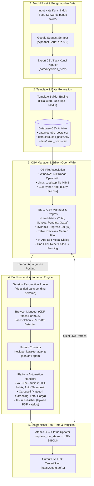

# 📋 Master Architecture & Roadmap Plan (`plan.md`)

Dokumen rancangan arsitektur sistem, status implementasi modul, dan peta jalan (roadmap) fitur untuk ekosistem **Bot Auto-Posting & Keyword Intelligence**.

---

## 🏗️ 1. Arsitektur Sistem & Aliran Data (System Architecture)



---

## 📌 2. Status Implementasi Fitur (Feature Checklist)

### Phase 1: Core Engine & Automation (SELESAI ✅)
- [x] **Scraper Google Suggest**: Mendukung metode *Alphabet Soup* (A-Z dan 0-9) dengan *jitter delay* anti-blokir IP.
- [x] **Template Generator**: Konfigurasi pola judul otomatis (`{keyword_title}`), deskripsi, dan jalur file media.
- [x] **CDP Browser Integration**: Menempel langsung ke instance Google Chrome port 9222 tanpa memicu flag `navigator.webdriver`.
- [x] **YouTube Studio Auto-Uploader**:
  - Penanganan dialog upload dengan timeout handal.
  - Visibilitas **100% Publik** secara default (`tp-yt-paper-radio-button[name='PUBLIC']`).
  - Thumbnail dibiarkan **otomatis** oleh AI YouTube dari frame video.
  - Verifikasi live berhasil pada 3 video publik: `0VT1IhcgRs8`, `kSzsBEy0TOI`, `fjhL2_0Kq8Y`.
- [x] **Carousell Marketplace Uploader**: Penanganan kategori Gardening, pemilihan kondisi barang, dan input harga.
- [x] **Issuu Publisher**: Otomatisasi pengunggahan dokumen PDF katalog.

### Phase 2: GUI, Open With & CSV Manager (SELESAI ✅)
- [x] **Desktop GUI Cross-Platform (CustomTkinter)**:
  - Antarmuka Dark/Light theme modern dengan background worker thread (antarmuka tidak pernah freeze).
- [x] **Integrasi "Open With" Windows**:
  - Script installer registry HKCU (`register_open_with_windows.bat`).
  - Menu klik kanan pada file `.csv`: *"Buka dengan Bot Auto-Posting"*.
- [x] **Integrasi "Open With" Linux**:
  - Desktop entry MIME `text/csv` (`bot-posting.desktop` + `install_desktop_linux.sh`).
- [x] **Tab "📊 CSV Manager & Progres"**:
  - Ringkasan metriks: Total Baris, Sukses, Pending, Gagal, Dilewati.
  - Visual Progress Bar (%) dan petunjuk nomor baris yang siap diproses berikutnya.
  - Preview tabel interaktif (Treeview) dengan pewarnaan tag status (Hijau/Kuning/Merah/Abu-abu).
  - Live Search judul/kata kunci dan Filter status.
- [x] **Editor Baris Interaktif (`EditRowDialog`)**:
  - Klik ganda atau klik tombol "Edit Baris" untuk menyunting judul, file media, status, visibilitas, tag, harga, dan deskripsi.
- [x] **Aksi Cepat Manajemen Antrian**:
  - Tombol **"🔄 Reset Gagal"**: Mengembalikan semua baris error ke status `pending` dalam 1 klik.
  - Tombol **"🌐 Buka URL"**: Membuka tautan postingan resmi langsung di browser.
  - Tombol **"➕ Tambah Baris"** & **"🗑 Hapus Baris"**.
- [x] **Pelanjutan Sesi (Resumable Auto-Posting)**:
  - Tombol **`▶ LANJUTKAN POSTING DARI FILE INI`** otomatis melompati baris sukses dan melanjutkan tepat dari baris pending pertama.
  - Pembaruan status tabel dan progress bar secara **live real-time** setiap kali satu postingan selesai.

---

## 🚀 3. Rancangan Fitur Spesifik Canva & Multi-Video (Phase 3)

Berikut adalah cetak biru teknis untuk 3 fitur yang diminta:

### 🎨 Fitur C1: Tombol "Ekspor ke Canva" (Canva Bulk Create 1-Kolom CSV)
- **Tujuan**: Memungkinkan pengguna langsung mengunduh daftar kata kunci hasil riset untuk diumpankan ke fitur *"Bulk Create"* (Buat Banyak) pada Canva, guna memproduksi puluhan hingga ratusan template video secara massal.
- **Format Data**:
  - Kolom tunggal dengan header: `Kata Kunci`.
  - Satu baris per kata kunci tanpa kolom tambahan lain (`category`, `scraped_at`, dll) agar Canva tidak bingung memetakan variabel teks.
- **Integrasi GUI**:
  - Tombol ungu `🎨 Ekspor ke Canva (Bulk Create)` di toolbar bawah Tab 3 (*🔍 Riset Kata Kunci*).
  - Menyimpan file ke `data/canva_bulk_keywords.csv` atau lokasi pilihan pengguna melalui file dialog.

### 📁 Fitur C2: Batch Video Folder Importer (Pemetaan Otomatis Banyak Video ke CSV)
- **Tujuan**: Memetakan otomatis puluhan/ratusan file video hasil download dari Canva (biasanya diekstrak ke satu folder) ke dalam kolom `video_path` baris-baris CSV antrian, tanpa perlu copy-paste manual satu per satu.
- **Mekanisme & Natural Sorting**:
  1. Pengguna memilih folder berisi kumpulan video (`.mp4`, `.mov`, `.mkv`, `.webm`).
  2. Sistem membaca file dan mengurutkan dengan **Natural Sort** (misal: `video 1.mp4`, `video 2.mp4` ... `video 10.mp4`, bukan urutan teks biasa yang meletakkan `10` sebelum `2`).
  3. Mengisi kolom `video_path` dari baris 1 s/d N secara berurutan.
- **Lokasi Integrasi**:
  - **Titik A (Tab 1: CSV Manager & Progres)**: Tombol `📁 Import Folder Video` di toolbar atas.
  - **Titik B (Tab 4: Template Builder)**: Pilihan mode media `File Tunggal` vs `📁 Folder Banyak Video`.

### 🧪 Fitur C3: Mode Test YouTube (Visibilitas "Private" / Pribadi)
- **Tujuan**: Menjalankan pengujian nyata upload YouTube Studio secara menyeluruh (verifikasi form, proses upload, deteksi link `https://youtu.be/...`), namun **TIDAK mempublikasikan video ke publik** agar tidak terlihat oleh penonton/subscriber channel.
- **Perbedaan Mendasar**:
  - **Dry-Run**: Mengisi form tapi *berhenti sebelum mengklik tombol Simpan/Publikasi* (tidak ada video yang tersimpan di YouTube).
  - **Mode Test (Private)**: *Menuntaskan seluruh proses upload hingga selesai terbit*, tetapi opsi visibilitas dipaksa ke **"Private" (Pribadi)** alih-alih "Public".
- **Integrasi GUI & Engine**:
  - Checkbox toggle `🧪 Mode Test (Upload sebagai Private / Pribadi)` di Tab 2 (*🚀 Bot Runner*).
  - Parameter `test_mode: bool = False` pada fungsi `upload_youtube_video()` di `poster_youtube.py`.
  - Dukungan argumen CLI `--test-mode` pada `poster_youtube.py`.

---

## 🔮 4. Rancangan Fitur Tambahan (Roadmap Lanjutan)

### Fitur R1: Pre-flight Media File Validator (Pengecekan Media Otomatis)
- **Tujuan**: Mencegah bot berhenti di tengah jalan akibat file video/gambar/PDF yang hilang, rusak, atau salah ketik path.
- **Mekanisme**:
  1. Tombol **"🔍 Validasi File Media"** pada tab CSV Manager.
  2. Memeriksa keberadaan file (`Path.exists()`), ukuran file (> 0 byte), dan validitas ekstensi media.
  3. Baris yang memiliki media tidak valid akan ditandai dengan ikon peringatan merah ⚠️ dan pesan penjelasan di kolom error.

### Fitur R2: Pengatur Kuota Harian Anti-Ban (Daily Safety Quota)
- **Tujuan**: Mencegah akun YouTube Studio atau Carousell terkena *shadowban* atau penalti algoritma akibat aktivitas berlebihan dalam waktu singkat.
- **Mekanisme**:
  1. Input pengaturan pada GUI: *"Batas Kuota Harian: [Misal 5 posting / hari]"*.
  2. Perekaman jumlah postingan harian di file konfigurasi lokal `data/.daily_quota.json`.
  3. Ketika kuota harian tercapai, bot berhenti secara anggun (*graceful stop*) dan memberikan notifikasi waktu reset kuota (misal: pukul 00:00).

### Fitur R3: Pemeriksa Duplikasi Konten (Intelligent Duplicate Detector)
- **Tujuan**: Mencegah upload judul atau video yang sama secara tidak sengaja.
- **Mekanisme**:
  1. Mendeteksi apakah ada judul yang identik atau file video yang sama di baris lain dalam file CSV yang sama.
  2. Opsi tombol: *"Tandai Baris Duplikat sebagai Skipped"*.

### Fitur R4: Ekspor Laporan Ringkasan (Success Report Exporter)
- **Tujuan**: Memudahkan pelaporan hasil kerja atau rekap postingan ke klien / manajemen.
- **Mekanisme**:
  1. Tombol **"📑 Ekspor Laporan Sukses"** pada CSV Manager.
  2. Menghasilkan file ringkas (CSV / Markdown / Teks Salin ke Clipboard) yang hanya memuat:
     - Nomor Urut
     - Judul Postingan
     - Live URL Resmi
     - Waktu Terbit

### Fitur R5: Penjadwal Otomatis di Background (Background Scheduler)
- **Tujuan**: Memungkinkan bot berjalan otomatis pada jam-jam prime time tanpa intervensi manual.
- **Mekanisme**:
  1. Pengaturan jam tayang (misal: "Setiap hari pukul 09:00, 13:00, dan 19:00").
  2. Integrasi dengan sistem penjadwalan lokal (Windows Task Scheduler / Linux Cron) atau timer internal Python non-blocking.

---

## 📁 4. Struktur Direktori Proyek yang Rapi

```
Bot-Posting/
├── app_gui.py                 # Aplikasi Desktop GUI Utama (CustomTkinter)
├── builder_template.py        # Generator file CSV template untuk 3 platform
├── config.py                  # Konfigurasi path, port CDP 9222, jeda waktu
├── INSTALL_WINDOWS.md         # Panduan instalasi dan pemakaian di Windows
├── plan.md                    # Dokumen master rancangan & roadmap fitur
├── poster_carousell.py        # Bot otomatisasi Carousell Marketplace
├── poster_issuu.py            # Bot otomatisasi Issuu PDF Publisher
├── poster_youtube.py          # Bot otomatisasi YouTube Studio (100% Publik)
├── PRD.md                     # Product Requirement Document asli
├── README.md                  # Dokumentasi proyek & gambaran umum
├── requirements.txt           # Daftar pustaka Python (cross-platform)
├── scraper_keyword.py         # Bot riset kata kunci Google Suggest
├── setup_windows.bat          # 1-Click Installer untuk Windows
├── start_chrome.bat           # Launcher Chrome Remote Debugging (Root Windows)
├── start_chrome.sh            # Launcher Chrome Remote Debugging (Root Linux)
├── start_gui.bat              # Launcher Aplikasi GUI (Root Windows)
├── start_gui.sh               # Launcher Aplikasi GUI (Root Linux)
├── assets/                    # Direktori media sampel
│   ├── docs/                  # Dokumen PDF katalog sampel
│   ├── images/                # Foto produk sampel
│   └── videos/                # File video MP4 sampel (15s & 30s)
├── data/                      # Penyimpanan data CSV
│   ├── carousell_posts.csv    # Antrian Carousell
│   ├── issuu_posts.csv        # Antrian Issuu
│   ├── keywords_pupuk_sawit.csv # Hasil scraping kata kunci
│   └── youtube_posts.csv      # Antrian YouTube Studio (457 baris)
├── launchers/                 # Kumpulan launcher sistem & integrasi OS
│   ├── bot-posting.desktop    # File asosiasi desktop Linux
│   ├── install_desktop_linux.sh # Script installer asosiasi Linux
│   ├── register_open_with_windows.bat # Registrasi menu klik kanan Windows
│   ├── setup_windows.bat      # Salinan installer Windows
│   ├── start_chrome_linux.sh  # Launcher Chrome Linux
│   ├── start_chrome_windows.bat # Launcher Chrome Windows
│   ├── start_gui_linux.sh     # Launcher GUI Linux
│   ├── start_gui_windows.bat  # Launcher GUI Windows
│   └── unregister_open_with_windows.bat # Penghapus menu klik kanan Windows
└── modules/                   # Modul pendukung (Clean Architecture)
    ├── browser_manager.py     # Pengelola koneksi CDP Playwright
    ├── csv_handler.py         # I/O CSV atomik & analisis progres
    ├── human_emulator.py      # Emulator ketikan & jeda manusiawi
    └── logger.py              # Sistem logging Rich berwarna
```

---

## 🪟 5. Ringkasan Instalasi Windows

1. **Prasyarat**: Pasang [Python 3.10+](https://www.python.org/downloads/) (centang *"Add Python to PATH"*), serta Google Chrome.
2. **Instalasi Cepat**: Klik dua kali file `setup_windows.bat`. Seluruh dependensi, driver Chromium, dan menu klik kanan *"Open With"* akan terpasang otomatis.
3. **Pemakaian Harian**:
   - Klik ganda `start_gui.bat` untuk membuka aplikasi.
   - Atau klik kanan file `.csv` antrian apa saja -> pilih **"Buka dengan Bot Auto-Posting"**.
